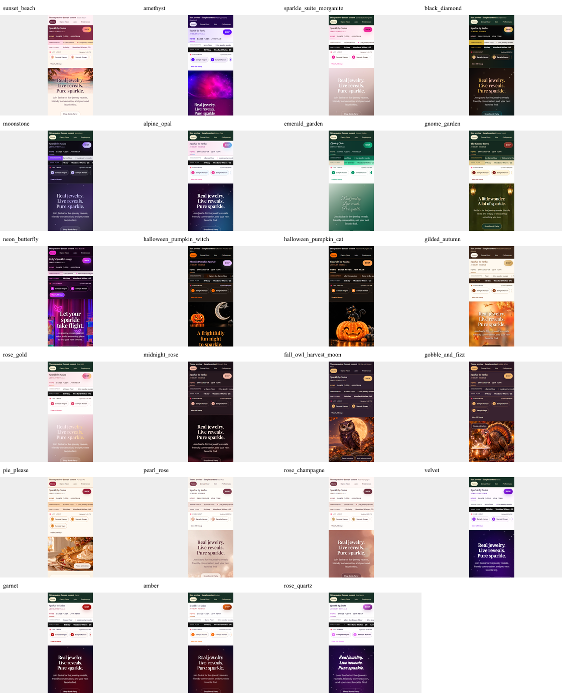
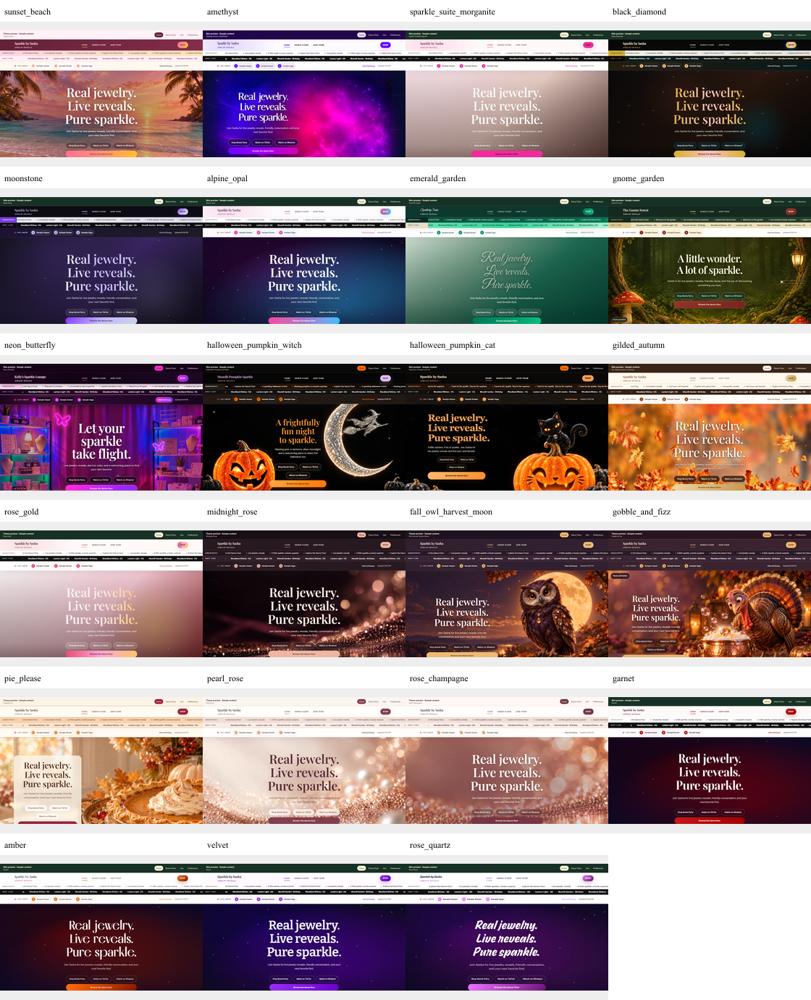

# Theme performance and first-paint evidence

All values are medians of five cold loads. All 46 theme/profile combinations pass LCP and CLS thresholds. These are lab measurements of the labeled sample-content theme preview routes; real rep-route measurements and full-suite limitations are reported separately in [the pass report](../2026-10-25-hero-autoplay-preview-pass2.md).

Phone: 360 x 800, DPR 1, slow 4G (1.6 Mbps down, 0.75 Mbps up, 150 ms latency), CPU 4x. Desktop: 1440 x 900, DPR 1, unthrottled. Installed Chrome 155.0.8059.81, cache disabled, empty context per run. LCP includes the outer navigation and iframe startup. No clicks occur during timing collection.

| Theme | Phone LCP (s) | Phone CLS | Desktop LCP (s) | Desktop CLS | First-run filmstrips |
|---|---:|---:|---:|---:|---|
| Sunset Beach | 1.743 | 0.0307 | 0.929 | 0.0148 | [Phone](phone-sunset_beach-1-filmstrip.png) / [Desktop](desktop-sunset_beach-1-filmstrip.png) |
| Chasing Unicorns (Amethyst) | 1.282 | 0.0073 | 0.746 | 0.0021 | [Phone](phone-amethyst-1-filmstrip.png) / [Desktop](desktop-amethyst-1-filmstrip.png) |
| Sparkle Suite / Morganite | 1.654 | 0.0293 | 0.835 | 0.0151 | [Phone](phone-sparkle_suite_morganite-1-filmstrip.png) / [Desktop](desktop-sparkle_suite_morganite-1-filmstrip.png) |
| Black Diamond | 1.756 | 0.0295 | 0.603 | 0.0147 | [Phone](phone-black_diamond-1-filmstrip.png) / [Desktop](desktop-black_diamond-1-filmstrip.png) |
| Moonstone | 1.605 | 0.0299 | 0.812 | 0.0152 | [Phone](phone-moonstone-1-filmstrip.png) / [Desktop](desktop-moonstone-1-filmstrip.png) |
| Alpine Opal | 1.711 | 0.0296 | 0.756 | 0.0016 | [Phone](phone-alpine_opal-1-filmstrip.png) / [Desktop](desktop-alpine_opal-1-filmstrip.png) |
| Emerald Garden | 1.717 | 0.0200 | 0.690 | 0.0127 | [Phone](phone-emerald_garden-1-filmstrip.png) / [Desktop](desktop-emerald_garden-1-filmstrip.png) |
| Gnome Forest | 1.790 | 0.0243 | 0.686 | 0.0131 | [Phone](phone-gnome_garden-1-filmstrip.png) / [Desktop](desktop-gnome_garden-1-filmstrip.png) |
| Neon Butterfly | 1.913 | 0.0270 | 1.077 | 0.0197 | [Phone](phone-neon_butterfly-1-filmstrip.png) / [Desktop](desktop-neon_butterfly-1-filmstrip.png) |
| Halloween Pumpkin and Witch | 1.925 | 0.0236 | 0.849 | 0.0055 | [Phone](phone-halloween_pumpkin_witch-1-filmstrip.png) / [Desktop](desktop-halloween_pumpkin_witch-1-filmstrip.png) |
| Halloween Pumpkin and Cat | 1.162 | 0.0042 | 0.723 | 0.0006 | [Phone](phone-halloween_pumpkin_cat-1-filmstrip.png) / [Desktop](desktop-halloween_pumpkin_cat-1-filmstrip.png) |
| The Golden Leaves of Autumn | 1.792 | 0.0319 | 0.838 | 0.0142 | [Phone](phone-gilded_autumn-1-filmstrip.png) / [Desktop](desktop-gilded_autumn-1-filmstrip.png) |
| Rose Gold | 1.721 | 0.0298 | 0.652 | 0.0152 | [Phone](phone-rose_gold-1-filmstrip.png) / [Desktop](desktop-rose_gold-1-filmstrip.png) |
| Midnight Rose | 1.916 | 0.0311 | 0.809 | 0.0148 | [Phone](phone-midnight_rose-1-filmstrip.png) / [Desktop](desktop-midnight_rose-1-filmstrip.png) |
| Fall Owl and Harvest Moon | 1.928 | 0.0085 | 0.903 | 0.0098 | [Phone](phone-fall_owl_harvest_moon-1-filmstrip.png) / [Desktop](desktop-fall_owl_harvest_moon-1-filmstrip.png) |
| Gobble & Fizz | 1.785 | 0.0101 | 0.736 | 0.0087 | [Phone](phone-gobble_and_fizz-1-filmstrip.png) / [Desktop](desktop-gobble_and_fizz-1-filmstrip.png) |
| Pumpkin Pie | 1.838 | 0.0101 | 0.763 | 0.0088 | [Phone](phone-pie_please-1-filmstrip.png) / [Desktop](desktop-pie_please-1-filmstrip.png) |
| Pearl Rose | 1.861 | 0.0269 | 0.886 | 0.0153 | [Phone](phone-pearl_rose-1-filmstrip.png) / [Desktop](desktop-pearl_rose-1-filmstrip.png) |
| Rose Champagne | 1.794 | 0.0311 | 0.821 | 0.0148 | [Phone](phone-rose_champagne-1-filmstrip.png) / [Desktop](desktop-rose_champagne-1-filmstrip.png) |
| Velvet | 1.620 | 0.0357 | 0.700 | 0.0293 | [Phone](phone-velvet-1-filmstrip.png) / [Desktop](desktop-velvet-1-filmstrip.png) |
| Garnet | 1.283 | 0.0137 | 0.567 | 0.0031 | [Phone](phone-garnet-1-filmstrip.png) / [Desktop](desktop-garnet-1-filmstrip.png) |
| Amber | 1.484 | 0.0111 | 0.580 | 0.0091 | [Phone](phone-amber-1-filmstrip.png) / [Desktop](desktop-amber-1-filmstrip.png) |
| Rose Quartz | 1.206 | 0.0140 | 0.620 | 0.0064 | [Phone](phone-rose_quartz-1-filmstrip.png) / [Desktop](desktop-rose_quartz-1-filmstrip.png) |

The [five-run samples](summary.json) identify their source commit. Twenty unchanged phone themes retain measurements from `7d5874c9`; [byte comparisons](unaffected-delivery.json) show identical delivered CSS/font markup on `4d5459f4`. Garnet, Amber and Rose Quartz phone measurements and all desktop measurements use `4d5459f4`. Subsequent changes (`df58c555`, `fba6acda`) affect only public rep request loading and analytics scheduling (analytics is excluded from theme previews); theme preview rendering, browser scripts, fonts and artwork are unchanged. Original failed phone samples remain in the local artifact archive.

Filmstrips include the initial network wait. No unstyled page flash or content disappearance after first paint was observed. A filmstrip is the first run, not a cherry-picked median run. Sunset Beach phone run 1 is 2.573s; its median is 1.743s.

## Settled overview

